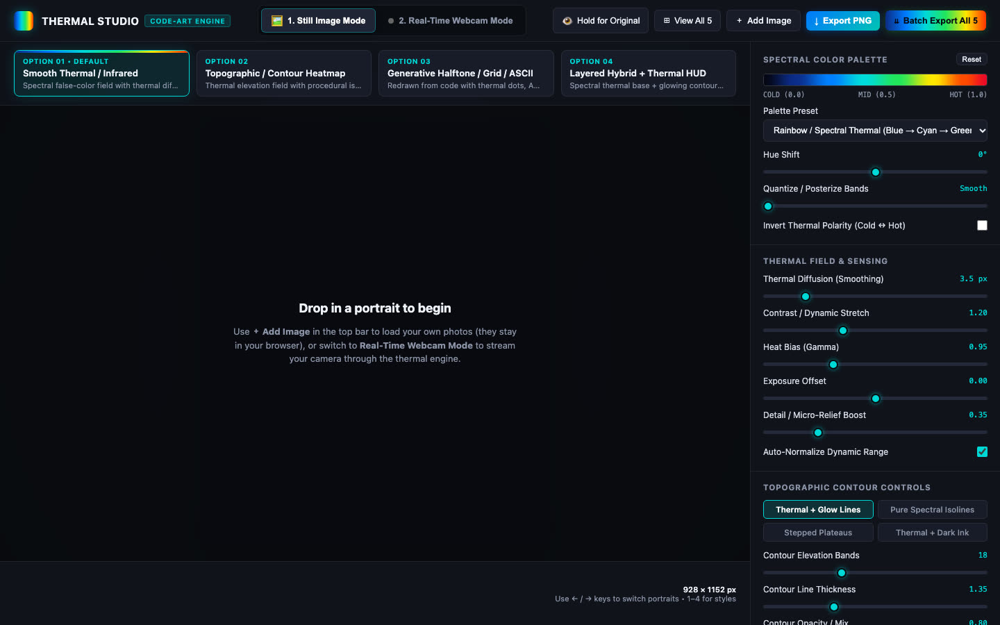

# THERMAL STUDIO: code-art heat-map engine walkthrough

A small, fast project: built in one Antigravity session (about 43 minutes elapsed), then organised and published by Claude Code the same night. Times are America/New_York (EDT), Oct 13 to 14, 2026.

## Outcome and context

THERMAL STUDIO redraws portraits (still mode) and live webcam footage (real-time mode) as thermal heat-map imagery, entirely in the browser with plain HTML, CSS and JavaScript and no build step. DJ Kim's request: stylize a folder of portraits "in the same style by redrawing them with code" with "an aesthetic heat map-style image", then add a real-time webcam mode with the same parameters.

- Live: https://fl4meboi.github.io/thermal-engine/ (GitHub Pages). Repo: https://github.com/fl4meboi/thermal-engine (public, `main`, 3 commits).
- Code: `index.html`, `app.js`, `styles.css`. No dependencies.
- Contributors: DJ Kim (direction, testing) with the Antigravity CLI using Gemini 4 Argon (Medium) for the app, and Claude Code (Sonnet 5.5) for the repo, Pages and tracking move.

## Stage 1: Heat-map still engine (Oct 14, 00:04 to 00:12; Antigravity + Gemini 4 Argon)

DJ pointed the agent at `~/VSCode/code-art` and its five PNG portraits (`Portrait Photography-1` to `-5`, 928 x 1152; their origin is not recorded). Two earlier Antigravity conversations that night (23:13 to 23:18, 23:56) were Q&A about what Gemini 4 Argon can build and how to prepare video inputs; they produced no code.

The agent viewed two images, asked one clarifying question about style and output, bundled the five images as base64 in `images-data.js` (7.6 MB), and wrote `styles.css`, `index.html` and `app.js`. Result: four selectable looks, switchable with keys 1 to 4:

1. Smooth thermal / infrared (default): luminance becomes a Gaussian-diffused heat field mapped through a spectral palette, with bloom, chromatic dispersion and sensor grain.
2. Topographic / contour heat map (four sub-styles).
3. Generative halftone, ASCII matrix, wave scanlines or sensor grid, redrawn from the field.
4. Layered hybrid with a thermal HUD that marks the hottest and coldest points.

Six palettes, hue shift, posterize bands, polarity invert, hold-to-compare, a five-up grid view and single or batch PNG export (928 x 1152) are included. The agent opened the page at 00:11; at 00:17 DJ replied "I like this one".

## Stage 2: Webcam mode (00:17 to 00:22; Antigravity)

DJ asked for two top-level modes: still image, and real-time video from the webcam using the same parameters. The agent rewrote the three files to add a mode switcher, a live loop with 480p / 640p / 720p processing, mirror, freeze (Space), snapshot PNG, WebM or MP4 recording and a moving MAX/MIN HUD that follows the warmest and coolest points of a face.

## Stage 3: Repo, folder and hosting (00:33 to 00:43; Claude Code)

Request: make a public repo named `thermal-engine` under the `fl4me.boi` GitHub account, move the files into a folder of that name under `code-art`, and keep the Antigravity conversation tracked with the folder after the move.

- No `fl4me.boi` login existed on the Mac; the only match was `fl4meboi`, used by passing its token for one command so the active `gh` account stayed unchanged. The commit email was the noreply address.
- The two portraits and the base64 bundle are gitignored as media (`source/`, `images-data.js`), so the public repo has no sample images and the app runs with an empty-state hint.
- Antigravity stores the workspace path in protobuf blobs, so a naive text replace would corrupt them. Claude Code wrote a wire-format-aware re-pointer, ran it on copies, checked the database integrity (36 steps intact) and applied it with the sessions closed. Originals are in `~/.gemini/antigravity-cli/_backup_before_repoint_20261014_003927/`.
- GitHub Pages was enabled on `main`; page, JS and CSS returned 200. Claude did not open it in a browser.

## Stage 4: Hosted-site bug and fix (00:45 to 00:50; Antigravity, then Claude Code)

DJ reported that the hosted site said "Drop a portrait to begin" over the live webcam. Cause: with `images-data.js` absent on Pages, the still-mode empty overlay was never hidden when switching modes. Antigravity patched `app.js` (hide on mode switch, drag-and-drop onto the canvas, guard arrow keys with no images, uploads return to still mode). Claude Code found these uncommitted edits, read them, committed `c1c2bff` and pushed; Pages served the new `app.js` after the build.

## Final delivery and verification

- Final: the Pages site and the repo above; local copy `~/VSCode/code-art/thermal-engine/` with the portraits in `source/Images/` (not committed).
- Checked: Pages and assets return HTTP 200 (re-checked Oct 14); the deployed `app.js` contains the fix (Claude Code); an Oct 14 headless-browser capture of the live site (image above) shows the still-mode UI loading with its controls.
- Not verified: webcam permission flow, live FPS and recording on the hosted site, mobile behaviour, any output from real portraits on the hosted site (it has none).
- No `deliverables/` folder exists; the README notes it is not yet created. No exported stills or videos have been saved.

## Time and cost

- Antigravity session `e58ca1a5`: first prompt 00:04:25, last answer 00:47:34 (about 43 min elapsed including waits for DJ). Summed per-step token counters from its transcript: 245,369 input, 1,102,806 cache-read, 62,945 output; no dollar figure is recorded.
- Claude Code session: 00:33 to 00:50 elapsed (about 17 min); active human time, token use and cost not recorded.
- GitHub and Pages: no charge recorded (public repo, standard Pages). Subscriptions are existing overhead and not allocated.

## Maintenance and handoff

- Version: code is committed and pushed. `docs/` is new and uncommitted. Keep `source/Images/` and `images-data.js` local; check usage rights before publishing sample portraits (the public site intentionally has none).
- Resume the agent conversation with `cd ~/VSCode/code-art/thermal-engine && agy` (Antigravity CLI). The earlier conversation `fdbf74ca` is still tied to `~/VSCode/code-art`.
- Regenerate the bundle: write `window.PORTRAIT_IMAGES = [{name, filename, src: "data:image/png;base64,..."}, ...]` into `images-data.js` from the PNGs in `source/Images/` (the format the Antigravity script produced).
- Open items: save a few exported stills or a webcam recording into `deliverables/`; decide whether to bundle licensed sample portraits for first-time visitors.
